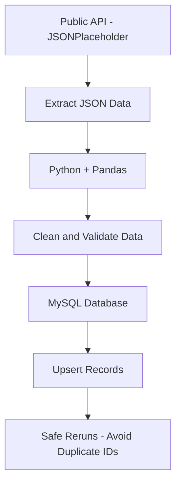

# Public API to MySQL ETL Pipeline

A simple data engineering project that extracts user data from a public API, transforms it using Python and Pandas, and loads it into MySQL.

## Workflow



## Tech Stack

- **Python**
- **Pandas**
- **Requests**
- **SQLAlchemy**
- **PyMySQL**
- **MySQL**

## ETL Process

1. **Public API:** Fetch user records in JSON format.
2. **Python + Pandas:** Extract, flatten, clean, and validate the data.
3. **MySQL:** Store the processed records in a database table.
4. **Safe Reruns:** Use an upsert strategy to insert new users and update existing users without duplicating IDs.

## Run the Project

Install the required dependencies:

```bash
pip install -r requirements.txt
```

Run the Python script:

```bash
python main.py
```

## Output

The processed user records are stored in the `users` table in the `api_etl_project` database.

## Key Learning

- REST API data extraction
- JSON processing and data transformation
- ETL pipeline development
- MySQL database integration
- Error handling and logging
- Idempotent loading using upsert logic
